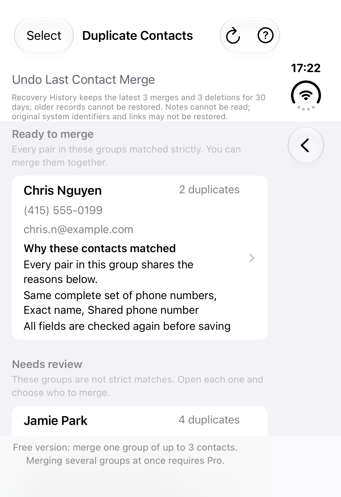
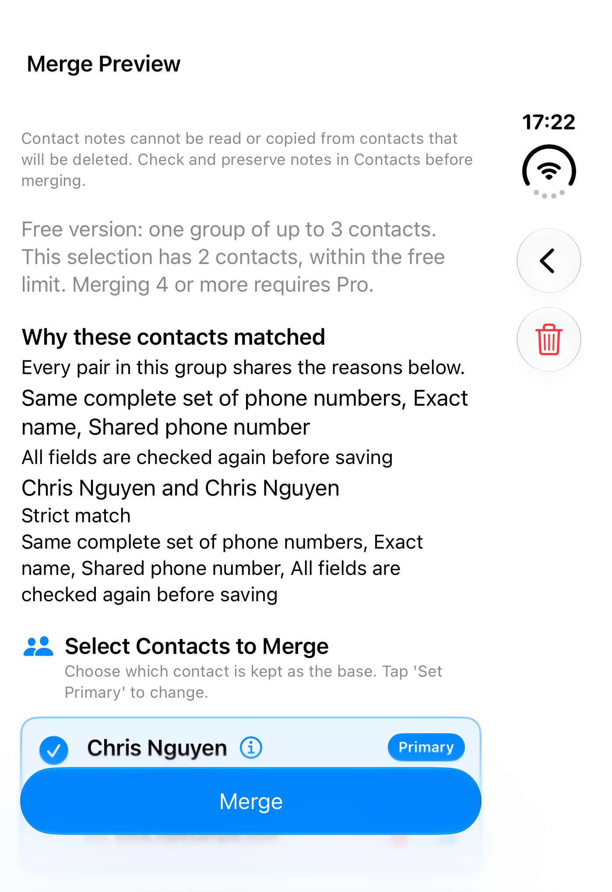

# 快速入門：安全掃描與合併聯絡人

- **總覽與語言**：[繁體中文總覽](../readme/README.zh-Hant.md) | [英文總覽（English）](../../README.md) | [本指南英文版（English）](../en/quick-start.md)
- **操作指南**：**快速入門** | [備份與復原](recovery.md) | [權限與疑難排解](permissions-troubleshooting.md) | [常見問題（FAQ）](faq.md)

本指南說明如何在 iPhone 上使用 **ContactMerge+ Cleaner** 找出、核對並安全合併重複的聯絡人。

ContactMerge+ Cleaner 會在您的裝置本機處理聯絡人資料，不會將您的通訊錄上傳至開發者伺服器，亦不提供開發者雲端備份服務。（iOS 或帳號聯絡人同步——例如 iCloud 或 Google——以及系統或裝置備份屬於獨立運作的機制，由您自身的帳號與 iOS 設定控制。）產品資訊與下載連結請參閱[官方網站（英文）](https://contactmerge.app)。

## 開始前的準備

- **建立獨立且標註日期的備份（強烈建議）**：匯出 `.vcf`（vCard）檔案屬於選用步驟——合併前並非強制匯出——但強烈建議您保留一份獨立且標註日期的備份，特別是在首次清理通訊錄之前。請確認備份涵蓋實際存放聯絡人的來源帳號，且包含預期的聯絡人紀錄。帳號同步（如 iCloud 或 Google）並非獨立備份，因為合併後的變更可能會同步至其他連線裝置。詳情請參閱[備份、復原上次合併與復原紀錄](recovery.md)以及[在 iPhone 合併聯絡人前先備份（英文）](https://contactmerge.app/guides/backup-contacts-before-merge-iphone)。
- **等待換機移轉與初次同步完成**：若您剛設定新 iPhone、使用過 `Move to iOS`（移轉到 iOS），或剛新增電子郵件／雲端帳號，請先等待背景同步完成後再執行掃描與合併（等待同步完成可避免同步期間資料變動造成混亂，但單靠等待並不保證能自動消除既有的重複項目）。

## 逐步合併操作流程

1. **授予聯絡人取用權限**：在 iOS 彈出提示時允許取用聯絡人。若未出現提示，或可見的聯絡人清單似乎不完整，請參閱[權限設定與疑難排解](permissions-troubleshooting.md)。
2. **掃描通訊錄**：在 ContactMerge+ Cleaner 中執行掃描，檢視重複聯絡人候選群組。
3. **點開單一群組並檢視預覽**：點選一個重複群組，檢查合併預覽畫面（`Merge Preview`），並指定要保留為基底的主要聯絡人名片。
4. **確認前先在 Apple「聯絡人」App 檢查備註（`Notes`）並核對欄位**：
   - 非主要聯絡人（將被合併的其他名片）上的重要 `Notes`（備註欄位）**不會**被讀取或複製到主要聯絡人，事後也無法復原。
   - **請在 Apple「聯絡人」App 檢查備註，而非僅看預覽畫面**：ContactMerge+ Cleaner 無法讀取聯絡人的 `Notes` 欄位。切勿因為 ContactMerge+ Cleaner 預覽畫面中未顯示任何備註，就認定該名片沒有備註——合併前請開啟 Apple 內建的**「聯絡人」（`Contacts`）**App 檢查各張名片，並手動將重要備註複製到主要聯絡人中。
   - **在外部檢視或編輯後請重新核對**：若您暫時離開 ContactMerge+ Cleaner 前往 Apple「聯絡人」App 檢視或修改聯絡人，返回後請先重新核對目前的重複候選清單與合併預覽，再行確認。請勿假設原先已開啟的候選清單或預覽畫面會自動重新整理或自動重新掃描。
   - **確認真實身分與預期欄位**：僅在確定各張名片在現實中確實屬於同一人，且預覽畫面保留了您預期的欄位資訊時，才確認執行合併。

### 畫面範例：掃描結果與合併預覽

*掃描結果 — 使用虛構聯絡人的模擬器示範畫面（英文介面，擷取於 2026-11-03）。實際畫面、版面配置與文字可能因您安裝的 App 版本或 iOS 版本而異。*

*合併預覽與主要聯絡人選擇 — 使用虛構聯絡人的模擬器示範畫面（英文介面，擷取於 2026-11-03；第二筆聯絡人列位於可見捲動區域下方，因此兩張名片未同時顯示於同一畫面中）。實際畫面、版面配置與文字可能因您安裝的 App 版本或 iOS 版本而異。*

## 認識群組分類：`Ready to merge` 與 `Needs review`

ContactMerge+ Cleaner 會依據現有的比對證據，將重複候選群組分為兩個區塊（本文件旨在說明安全的檢視習慣，並不宣稱精確的內部執行期比對門檻或文字／號碼正規化規則）：

- **`Ready to merge`（合併就緒）**：
  - 群組內**每一對**聯絡人名片皆具備明確證據，並通過嚴格比對檢查。
  - **仍須檢視預覽**：僅共用相同姓名或電話號碼並不足以證明兩張名片代表同一人。確認合併前，請務必檢視預覽內容，並前往 Apple 內建的**「聯絡人」（`Contacts`）**App 檢查 `Notes` 備註。
  - 在您確認後，可納入 Pro 專業版的批次合併。
- **`Needs review`（需人工檢視）**：
  - 名片之間的比對證據較弱或存在衝突——例如共用家庭或辦公電話號碼、姓名寫法差異、生日衝突，或僅有部分欄位重疊。
  - 出現 `Needs review` 是保守的安全保護機制，並非掃描錯誤：姓名不同不代表一定是兩位不同的人，而共用電話或相同姓名仍可能分屬不同家庭成員或同事。
  - 必須逐組單獨人工檢視與確認。`Needs review` 群組絕不會納入批次合併，也沒有可將模糊群組強制轉入批次合併的設定。若兩張名片代表不同人，請保持不合併。

## 免費版（Free）與專業版（Pro）功能比較

- **Free（免費版）**：
  - 掃描並檢視所有偵測到的重複聯絡人群組。
  - 每次單獨合併 1 個重複群組，且該群組內最多包含 3 張聯絡人名片（不包含跨群組批次合併）。
- **Pro（專業版）**：
  - App Store 一次性買斷解鎖，無訂閱制；Apple 會直接顯示您所在商店地區的售價。
  - 解鎖包含超過 3 張聯絡人名片的群組合併，以及經確認後的 `Ready to merge` 群組批次合併（`Needs review` 群組仍須逐組人工檢視）。
  - 免費版與專業版皆不承諾特定的掃描速度或無限通訊錄容量上限。
  - 有關回復購買或 Apple 退款規定，請參閱[常見問題（FAQ）](faq.md#q15)或聯絡[官方支援（英文）](https://contactmerge.app/support)。

## 相關指南與支援資源

- [備份、復原上次合併與復原紀錄](recovery.md)
- [權限設定與疑難排解](permissions-troubleshooting.md)
- [常見問題（FAQ）](faq.md)
- [如何安全合併聯絡人（英文）](https://contactmerge.app/guides/merge-contacts-safely)
- [在 iPhone 合併聯絡人前先備份（英文）](https://contactmerge.app/guides/backup-contacts-before-merge-iphone)
- [官方支援（英文）](https://contactmerge.app/support)
- [隱私權政策（英文）](https://github.com/chenhuaizhe/ContactMergeApp/blob/main/privacy-policy.md)

## 文件狀態

核對日期：2026 年 11 月 8 日。實際畫面、介面標籤與行為可能因您所安裝的 App 版本及 iOS 版本而異。
